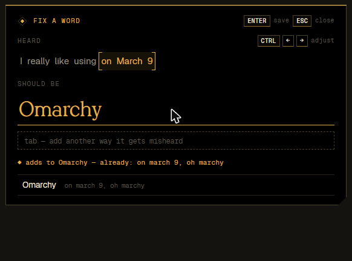

# Mimic

**A private, local layer between your mic and your ears.** Mimic types what you say wherever your cursor is,
follows your calls, and can answer for you, in your own voice, through your microphone. It also has a soundboard.
Everything runs on your PC: the speech models, the language model and the voice.

Mimic is a fork of [Fluss](https://github.com/eigenpair/fluss), the dictation app, with an agent layer on top.
Windows 10/11, x64.

<p align="center"></p>

## Install

Download `Mimic_x.y.z_x64-setup.exe` from [Releases](https://github.com/mflRevan/mimic/releases) and run it.
No admin rights are needed. Onboarding walks you through picking a microphone and a speech model.

The agent needs a GPU and ~30 GB of models (a local LLM and the voice). Set it up once with
`powershell -File scripts\setup-agent.ps1`, then turn it on in the app's **Agent** page or with `mimic agent on`.

**Updates install themselves.** Every 3 hours Mimic looks at this repository's latest release. A newer version
(~6 MB, checked against the SHA-256 GitHub records) is installed as soon as nothing is going on: no dictation, and
the agent quiet for 3 minutes. That takes a few seconds, and Mimic comes back in the tray. Turn it off on the About
page (`general.auto_update`); `mimic update` installs the latest version right away. Before a new version first
starts, your settings and dictionary are copied to `%LOCALAPPDATA%\Mimic\backups\<old version>`.

**Uninstall** from Windows Settings → Apps, or with `mimic uninstall`. Settings, dictionary and models stay unless
you tick *Delete the application data*.

## Dictation

- **Push-to-talk** (<kbd>Ctrl</kbd>+<kbd>Win</kbd>) and **hands-free** (<kbd>Ctrl</kbd>+<kbd>Win</kbd>+<kbd>Space</kbd>,
  or double-tap) with a live preview. Every shortcut can be changed, including mouse buttons and single keys.
- **Pre- and post-roll** (0.5 s each): words said just before pressing or just after letting go are kept.
- **Continuation that understands the seam.** Dictating again into the same field re-decodes the end of the
  previous audio with the new audio, so a period guessed too early becomes a comma and the next word stays lowercase.
- **One-second corrections.** Right after a word comes out wrong, press <kbd>Ctrl</kbd>+<kbd>Win</kbd>+<kbd>R</kbd>:
  the popup is already filled in with what you just said ("on March 9"), you type what it should be ("Omarchy"),
  and the rule is saved and the text fixed in place.
- **Text layer**: spoken punctuation, filler removal, lowercase mode, your dictionary (also passed to the model as hotwords).
- **Models**

  | Model | Size | Runs on | Languages |
  |---|---|---|---|
  | **Phonon 2.5 English** (default) | 158 MB | CPU (AVX-512/AVX2) | English |
  | Phonon 2.5 Multilingual | 170 MB | CPU | 25 European |
  | Parakeet TDT 0.6B v3 | 2.5 GB | GPU (DirectML, any DX12 GPU) or CPU | 25 European |
  | Custom endpoint | — | anywhere | depends |

  The custom endpoint is any OpenAI-compatible `POST /v1/audio/transcriptions` server (OpenAI, Groq, whisper.cpp, …).

<p align="center"></p>

## The agent

```
 your mic ──▶ tap ──┬──▶ virtual mic (passthrough) ──▶ Discord, Zoom, ...
                    ├──▶ voice bank (your last clean phrases) ──▶ clone reference
                    └──▶ VAD ─▶ phrases ─▶ STT ─▶ "me" / private (shortcut, wake word) ─▶ router ─▶ action | context | LLM
 hear: app:Discord ─▶ VAD ─▶ phrases ─▶ end of turn? ─▶ STT + speaker embedding ─▶ "Speaker 2: ..."
                                                │
       setting + context.md + the conversation as chat turns ─▶ LLM ─▶ Drama 3 (your voice) ─▶ virtual mic + your ears
```

- **Hears** what you pick: one app (`app:Discord`, process loopback, so just the call) or everything an output plays,
  transcribed with the dictation models.
- **Hears when someone is done.** [Silero VAD](https://huggingface.co/onnx-community/silero-vad) separates speech from
  noise, and [Smart Turn v3.2](https://huggingface.co/pipecat-ai/smart-turn-v3) (~25 ms on the CPU) judges from
  intonation whether the speaker has finished: a finished turn is answered at once, "I was going to say that maybe we
  could also…" gets more time. Questions always get an answer, acknowledgements ("okay, thanks") never reach the model.
- **Tells voices apart.** Each phrase gets a speaker embedding ([ReDimNet2-B3](https://huggingface.co/diarizeapp/redimnet2-b3-onnx))
  matched against a persistent book of voices by average similarity to each voice's recent clips. Lines read
  "Speaker 2: …"; tell it privately **"name the last speaker Ben"** (or "name speaker 2 Ben") and that voice is Ben
  from then on, in this call and the next. You can also rename voices in the app.
- **Is you.** The model sees the call as a chat in which everything you said, yourself or through it, is its own
  earlier turns, and the others are named. It plays one of three settings you can edit: **Stand-in** (sounds like
  you, commits to nothing), **Fun** (you among friends) or **Sidekick** (its own personality, open about being an AI).
- **Knows what you tell it.** One context document (`%LOCALAPPDATA%\Mimic\context.md`): you, how you talk, people,
  the situation, facts, rules and a running summary. Brief it by talking privately (<kbd>Ctrl</kbd>+<kbd>Win</kbd>+<kbd>A</kbd>
  or the wake word, "Mimic, …"): clear phrasings ("this is Alex, my manager", "don't agree to dates") are handled
  without the model, anything else through its tools. The conversation part is forgotten after 20 quiet minutes.
- **Speaks as you.** [Drama 3](https://huggingface.co/fishaudio/drama-3) (35B MoE, int4, via
  [drama-rs](https://github.com/apiplant/drama-rs)) clones your voice zero-shot from your last ~12 s of clean speech
  and speaks each answer as one utterance. A jitter buffer keeps playback smooth when the GPU is busy. With 16 of
  40 expert layers on the GPU (the default) it needs ~11 GB of VRAM and starts speaking in ~0.5 s.
- **Yields when talked over**: it finishes its sentence (or stops at once, or keeps going) and remembers exactly
  what it got to say. A quick "mhm" doesn't count.
- **Thinks** with [Gemma 4 E4B](https://huggingface.co/ggml-org/gemma-4-E4B-it-GGUF) on a managed `llama-server`,
  or any OpenAI-compatible endpoint.
- **Shortcuts**: autopilot <kbd>Ctrl</kbd>+<kbd>Win</kbd>+<kbd>P</kbd> (it answers the call for you), answer now
  <kbd>Ctrl</kbd>+<kbd>Win</kbd>+<kbd>Enter</kbd>, stop <kbd>Ctrl</kbd>+<kbd>Win</kbd>+<kbd>X</kbd>.

**The virtual mic.** On Windows only a signed kernel driver can create a microphone, so Mimic plays into a virtual
cable you already have (*Steam Streaming Microphone*, VB-Cable, SteelSeries Sonar, …); pick its other end as the mic
in your call app. You hear the agent on your own output without any cable.

## Soundboard

Nine slots on <kbd>Alt</kbd>+<kbd>1</kbd>…<kbd>9</kbd> (changeable), WAV/MP3/OGG/FLAC, played into the virtual mic
and on your output, with master and per-slot volume. Press a slot again to stop it.

## Command line

```text
mimic status [--watch]           what Mimic is doing
mimic config list|get|set|reset  every setting, e.g. mimic config set audio.preroll_ms 300
mimic rules add Omarchy --heard "on march 9"
mimic model list|use|install|load|unload
mimic transcribe meeting.wav
mimic dictate start|stop|cancel
mimic agent status|on|off|autopilot|say|reply|stop|tell|context|log|voice|sources
mimic sound <1-9>|stop|list|set <slot> <file>
mimic update [--check|--install]
mimic history | logs -f | devices | doctor | autostart on|off | uninstall
```

Every command has `--help`, and `--json` for scripts.

## Architecture

```
 hotkey hook ─┐                     ┌─ engine thread ── Phonon (managed `fermion serve`, isolated Python via uv)
 microphone ──┼─▶ controller ──────▶│                ── Parakeet (ONNX Runtime in-process, DirectML)
 IPC (CLI/UI)─┘   segmenter,        └─                ── custom endpoint (HTTP)
                  previews, seams,
                  text pipeline ───▶ injector (SendInput / paste) ─▶ focused app
                                 └─▶ overlay (layered window, tiny-skia)
```

| Path | What |
|---|---|
| `crates/mimic-core` | Pure, unit-tested logic: config, hotkeys, dictionary, text pipeline, continuation, IPC protocol, updates. |
| `crates/mimic-core/src/agent` | The agent's logic: context, timeline, prompts and tools, routing, turn-taking, speakers, streaming parsers. |
| `crates/mimic-daemon` | The background app: Win32 hooks, audio, engines, overlay, tray, IPC server, updater. |
| `crates/mimic-daemon/src/agent` | The agent at runtime: hearing, thinking, speaking, managed model servers. |
| `crates/mimic-daemon/src/voiceaware` | VAD, end-of-turn and speaker-embedding models (ONNX Runtime). |
| `crates/mimic-daemon/src/router.rs` | The virtual mic: mic passthrough, the agent's voice, sound effects. |
| `crates/mimic-cli` | The `mimic` command. |
| `ui/` | Settings app, onboarding and correction popup (Tauri 2 + Svelte 5), a separate process that runs only while a window is open. |

## Development

Requirements: Rust (stable), Node 22, Windows 10/11 with the MSVC build tools.

```powershell
powershell -File scripts\check.ps1             # tests + UI build (-Quick: Rust tests only)
powershell -File scripts\install-hooks.ps1     # run the quick check before every push
cd ui; npm install; npm run dev                # settings UI in a browser, with a mock backend
powershell -File scripts\build-installer.ps1   # release binaries + NSIS installer (incremental)
powershell -File scripts\release.ps1           # publish the next version
```

**Releasing** is one command on a clean `main`: `scripts\release.ps1` (next patch, or `-Version 0.4.0`) bumps the
version (the workspace `Cargo.toml` is its only source), runs the tests, builds the installer, tags, pushes, publishes
a GitHub release with notes from the commit log and verifies the uploaded file's checksum. Installed copies update
themselves; `-Update` also updates this PC right away through the app's own updater.

**Testing without devices.** `file:<path.wav>` works as the mic (`audio.device`), as a hearing source
(`agent.hear.sources`) and as the virtual mic (`agent.route.output`, which records what would be sent), and
`MIMIC_HOME=<dir>` isolates settings, models and logs. Also: `MIMIC_LOG=debug`, `MIMIC_TEST_SINK=<file>` (type into a
file), `mimic-daemon --render-overlay <dir>`, `mimic-daemon --bench <model> <file.wav>`,
`mimic-daemon --voiceaware-check <dir of wavs>`, and `MIMIC_UPDATE_URL` for a test update feed.

Design language: [`docs/DESIGN.md`](docs/DESIGN.md), black and gold, Licht Serif / Geist / Geist Mono.

## Credits

- [Fluss](https://github.com/eigenpair/fluss), which Mimic is built on.
- [Phonon 2.5](https://huggingface.co/FermionResearch/Phonon-2.5-English) by Fermion Research (CC-BY-4.0);
  [Parakeet TDT 0.6B v3](https://huggingface.co/nvidia/parakeet-tdt-0.6b-v3) by NVIDIA (CC-BY-4.0), ONNX export by
  [istupakov](https://huggingface.co/istupakov/parakeet-tdt-0.6b-v3-onnx).
- [Gemma 4](https://huggingface.co/google/gemma-4-E4B-it) by Google; [Drama 3](https://huggingface.co/fishaudio/drama-3)
  by Fish Audio via [drama-rs](https://github.com/apiplant/drama-rs); [Smart Turn](https://github.com/pipecat-ai/smart-turn)
  by Pipecat (BSD-2); [Silero VAD](https://github.com/snakers4/silero-vad) (MIT); [ReDimNet2](https://github.com/IDRnD/redimnet2) by ID R&D.
- [Licht Serif](https://zon.sh/licht) by zon.sh (used with permission); [Geist and Geist Mono](https://vercel.com/font) by Vercel (OFL).
- Built with [Tauri](https://tauri.app), [Svelte](https://svelte.dev), [ONNX Runtime](https://onnxruntime.ai),
  [cpal](https://github.com/RustAudio/cpal) and [tiny-skia](https://github.com/RazrFalcon/tiny-skia).

MIT licensed.
